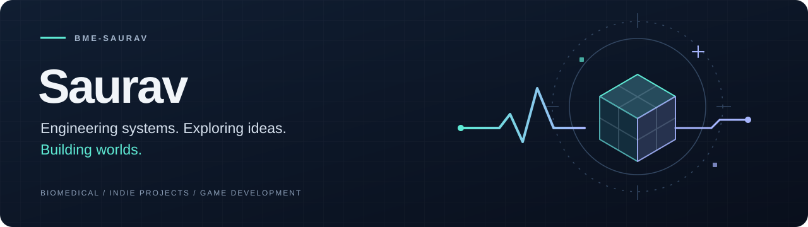

  

  <strong>Biomedical systems engineer · Indie hacker · Game dev enthusiast</strong>

  <a href="https://github.com/bme-saurav?tab=repositories">Explore my repositories</a>
  &nbsp; / &nbsp;
  <a href="https://github.com/bme-saurav?tab=stars">Things that inspire me</a>

### Hi, I'm Saurav.

I'm a systems engineer in the biomedical field, with an interest in independent projects and game development. I like the space where structured engineering meets creative experimentation.

Based in the **Land of Enchantment**.

### Three threads, one curious mind

| Biomedical systems | Independent ideas | Interactive worlds |
| :--- | :--- | :--- |
| Thinking about how the pieces fit together—and how the whole system serves people. | Exploring useful tools, small products, and ideas worth turning into something tangible. | Exploring mechanics, playful interactions, and the craft of making games. |

### Around here

This is a home for the things I build, explore, and learn along the way. My interests cross disciplines; the common thread is turning an idea into something that works.

Systems thinking. Creative curiosity. Room to experiment.

