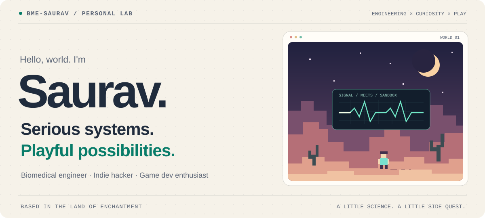
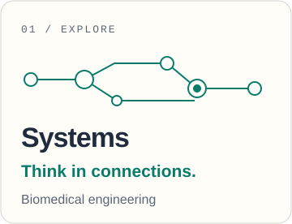
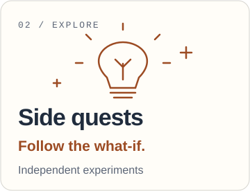
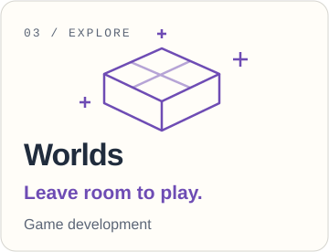

<picture>
  <source media="(prefers-color-scheme: dark)" srcset="assets/hero-dark.svg">
  
</picture>

  <a href="https://github.com/bme-saurav?tab=repositories"><strong>Explore the lab ↗</strong></a>
  &nbsp;&nbsp;·&nbsp;&nbsp;
  <a href="https://github.com/bme-saurav?tab=stars">Curiosity shelf</a>
  &nbsp;&nbsp;·&nbsp;&nbsp;
  <a href="https://www.linkedin.com/in/saurav010/">Say hello on LinkedIn</a>

## A systems mind. A maker's curiosity.

I'm **Saurav**, a systems engineer in the biomedical field, an indie hacker, and a game dev enthusiast in the **Land of Enchantment**.

I'm drawn to both sides of building: understanding how a complex system fits together, and experimenting with what it could become. Sometimes that's a useful tool. Sometimes it's a game mechanic. The interesting part is finding out.

### Pick a path

  <a href="#01--systems"><picture><source media="(prefers-color-scheme: dark)" srcset="assets/systems-dark.svg"></picture></a>
  <a href="#02--side-quests"><picture><source media="(prefers-color-scheme: dark)" srcset="assets/ideas-dark.svg"></picture></a>
  <a href="#03--worlds"><picture><source media="(prefers-color-scheme: dark)" srcset="assets/worlds-dark.svg"></picture></a>

#### 01 · Systems

My professional home is biomedical systems engineering. I'm interested in the connections between parts, the behavior of the whole, and the people a system is meant to serve.

#### 02 · Side quests

Indie hacking is my space for following an idea far enough to make it tangible: small tools, useful experiments, and learning by trying things.

#### 03 · Worlds

Game development brings out the playful side: mechanics to explore, interactions to tinker with, and worlds to imagine.

 

<picture>
  <source media="(prefers-color-scheme: dark)" srcset="assets/footer-dark.svg">
  
</picture>
